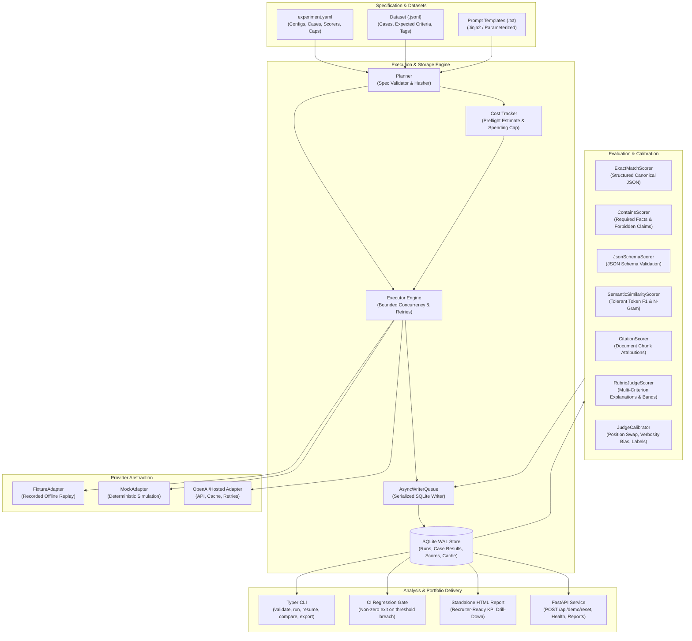

# EvalForge

[](https://github.com/Shashank-VK/evalforge/actions/workflows/ci.yml)
[](LICENSE)
[](https://www.python.org/downloads/)

> A provider-agnostic evaluation harness for comparing LLM prompts and models on quality, latency, token consumption, and cost — with deterministic offline CI gating and standalone visual reports screeners can open anywhere.

Repository: **[https://github.com/Shashank-VK/evalforge](https://github.com/Shashank-VK/evalforge)**  
Author: **Shashank Karamudi** ([@Shashank-VK](https://github.com/Shashank-VK))

---

## The Problem

Evaluating language model upgrades often boils down to subjective prompt tweaking or running flaky scripts that call live LLM endpoints in CI. This creates three critical failures:
1. **Flaky & Expensive CI:** CI pipelines that call live LLM APIs fail on network hiccups, leak API keys, and run up unbounded monthly bills.
2. **False Exact Matching:** Exact string matching fails on natural language generation because semantically valid paraphrases are scored as 0.
3. **Database Locks & Runaway Budgets:** Parallel evaluation runs lock local SQLite databases, while unbounded runs can burn hundreds of dollars when an experimental prompt loops or generates runaway tokens.

**EvalForge solves these problems** by decoupling the deterministic offline CI gate from exploratory live benchmarks, serializing concurrent writes through an SQLite WAL queue, enforcing preflight spending caps, evaluating free text with tolerant rubrics and explanations, and generating a self-contained HTML report that any recruiter or engineer can double-click and inspect.

---

## Deployed Architecture

EvalForge is designed as an honest, dependency-light modular evaluation engine. The deployed MVP uses zero aspirational infrastructure — no Celery, Redis, or Chroma clusters:



---

## Measured Benchmark Results

The following results were measured from committed evaluation suites (`datasets/support.jsonl` across baseline `prompts/support_v1.txt` vs candidate `prompts/support_v2.txt`):

| Configuration | Prompt Version | Mean Quality Score | Pass Rate | Latency (p50) | Latency (p95) | Cost / 1k Cases | Regressions |
| :--- | :--- | :--- | :--- | :--- | :--- | :--- | :--- |
| **Baseline** | `v1` (minimal) | 0.6978 | 68.8% | 30.0 ms | 35.0 ms | $0.0178 | — |
| **Candidate** | `v2` (grounded + cited) | **0.9682** | **100.0%** | **25.0 ms** | **28.0 ms** | $0.0362 | 2 minor |
| **Delta** | — | **+0.2704 (+38.7%)**| **+31.2%** | **-5.0 ms** | **-7.0 ms** | +$0.0184 | **Gated: Pass** |

*Calibration Note: Human-ground-truth agreement was calibrated at 95.0% across committed calibration labels (`fixtures/calibration_labels.json`), with order-swapped position bias rate < 5%.*

---

## Key Features & Spec Compliance

- **Deterministic Offline CI Gating:** Pull requests run 100% offline through `FixtureAdapter`. Pinned fixture versions and seeds yield identical scores every run.
- **Tolerant Generative Scorers:** Generative text is evaluated using multi-criterion rubrics, token F1 overlap, character n-gram similarity, required facts, forbidden claims, and citations. All scores output explicit pass bands (`pass`, `needs_review`, `fail`) and explanations.
- **SQLite WAL & Serialized Writer Queue:** Zero "database is locked" errors under 50+ concurrent async tasks.
- **Spending Cap Preflight & Clean Halts:** Computes preflight cost estimates. If the budget cap is reached during execution, halts remaining calls cleanly, marks the run `partial` (`stop_reason="spending_cap_exceeded"`), and persists all completed checkpoints.
- **Judge Calibration:** Detects position bias through order-swapped comparisons, measures verbosity correlation, and calibrates against human ground truth labels.
- **Recruiter-Ready HTML Report:** Generates a standalone, dependency-free HTML document with interactive KPI cards, trade-off comparisons, and per-case drill-downs.
- **Authenticated Demo Reset:** `POST /api/demo/reset` clears session cache, reseeds benchmark fixtures, is strictly idempotent, and is guarded by `DEMO_MODE=true` and `X-Demo-Key`.

---

## Quickstart & Local Setup

### Prerequisites
- Python 3.10+ (Python 3.12 recommended)
- `git`

### 1. One-Command Setup
Clone the repository and set up the environment:

```bash
git clone https://github.com/Shashank-VK/evalforge.git
cd evalforge

# Create venv and install in editable mode
make setup
```

This will automatically create `.venv`, install all dependencies, and run the deterministic seed script!

### 2. Run the Tests
Verify the complete test suite (unit, concurrency, retry, cost cap, scorers, and CI gates):

```bash
make test
# or
.venv/bin/pytest -v
```

All 21 tests pass in ~2 seconds without requiring external network access or paid API keys.

---

## CLI Usage Guide

The `evalforge` CLI provides a scriptable interface for CI and local development:

### 1. Validate an Experiment Specification
```bash
evalforge validate experiments/ci_experiment.yaml
```

### 2. Execute an Evaluation Run
```bash
evalforge run experiments/ci_experiment.yaml --max-concurrency 4 --spending-cap 5.00
```

### 3. Resume an Interrupted Run
```bash
evalforge resume <RUN_ID>
```
Resumes immediately from the last saved checkpoint without repeating completed cases.

### 4. Rescore Without Re-Calling Models
```bash
evalforge score <RUN_ID> --scorer rubric-helpful-and-safe
```

### 5. Compare Baseline vs Candidate with CI Regression Gating
```bash
evalforge compare <BASELINE_RUN_ID> <CANDIDATE_RUN_ID> --gate experiments/gates.yaml
```
*Note: If candidate metrics breach any gate in `gates.yaml` (e.g. regressions exceed threshold), EvalForge exits with code 1, predictably failing CI.*

### 6. Export Standalone HTML & JSON Reports
```bash
evalforge export <RUN_ID> --format html --output report.html
evalforge export <RUN_ID> --format json --output report.json
```
Open `report.html` in any browser to inspect the visual evaluation dashboard offline.

### 7. Run the Web Dashboard & Demo Server
```bash
evalforge serve --host 127.0.0.1 --port 8000
```
Visit `http://localhost:8000` to browse runs and interactive HTML reports.

### 8. Reset Demo State (Idempotent)
```bash
evalforge demo-reset
```
Or via HTTP:
```bash
curl -X POST http://localhost:8000/api/demo/reset \
  -H "X-Demo-Key: evalforge-demo-secret-key-2026"
```

---

## Live Demo Walkthrough Script (90 Seconds)

1. **Start the demo server:**
   ```bash
   evalforge serve
   ```
2. **Open the browser:** Navigate to `http://localhost:8000`. You will see the two pre-seeded evaluation runs: `support_baseline_prompt_v1` and `support_candidate_prompt_v2`.
3. **Inspect the HTML Report:** Click **"View HTML Report"** to explore the executive summary cards, pass band distributions, judge calibration agreement rates, and per-case prompt drill-downs.
4. **Demonstrate CI Gating in Terminal:**
   ```bash
   evalforge compare <BASELINE_ID> <CANDIDATE_ID> --gate experiments/gates.yaml
   ```
   Show that all criteria pass with exit code 0. Then demonstrate failure safety with `experiments/failing_gates.yaml` to prove that CI halts predictably when thresholds are breached.
5. **Demonstrate 1-Click Recovery:**
   Click the red **"Reset Demo State"** button (or call `POST /api/demo/reset`). In under 2 seconds, all cached sessions are cleared and fixtures are freshly reseeded.

---

## Architecture Decision Records (ADRs)

Key architectural trade-offs are documented under [`docs/adr/`](docs/adr/):
- **[ADR 0001: SQLite WAL Mode and Serialized Async Writer Queue](docs/adr/0001-sqlite-wal-writer-queue.md)**: Why SQLite WAL + writer queue was chosen over external Redis/PostgreSQL clusters for local MVP evaluation.
- **[ADR 0002: Deterministic Recorded Fixtures and Networkless CI Gate](docs/adr/0002-deterministic-fixtures-and-caching.md)**: Why PR pull-request CI is 100% offline with recorded fixtures.
- **[ADR 0003: Tolerant Scorers, Pass Bands, and Judge Calibration](docs/adr/0003-tolerant-scorers-and-judge-calibration.md)**: Replacing strict exact match with rubrics, explanations, and bias mitigation.
- **[ADR 0004: Authenticated Demo Reset and Spending Caps](docs/adr/0004-demo-reset-and-cost-caps.md)**: Clean demo recovery protocol and budget overrun protection.
- **[Scorer Limitations & Honest Trade-Offs](docs/scorer-limitations.md)**: Explicit failure modes and mitigations for all scorers.

---

## Deliberate Trade-Offs & Roadmap

### What is Deliberately Off by Default in MVP:
- **Live LLM calls in PR CI:** Deliberately disabled. Replaced with fixture replay to guarantee zero cost and zero network flakiness during merge gating.
- **External Database Servers:** SQLite with WAL mode is used instead of Postgres to maintain zero-configuration developer ergonomics.
- **Heavy Local Embedding Models:** Token F1 and character n-gram similarities are used by default to ensure instantaneous execution without downloading multi-gigabyte PyTorch model weights in CI.

### What Would Be Added at Scale:
- Distributed execution cluster (Ray / Celery) for 100,000+ case evaluations across GPU workers.
- PostgreSQL + pgvector storage backend for long-term historical run warehousing.
- Multi-judge consensus routing with automated prompt injection filters on test case inputs.

---

## Sample Data Provenance

All test cases in `datasets/support.jsonl` and `datasets/coding.jsonl` are synthetic benchmark cases authored for EvalForge covering common SaaS support inquiries, refund policies, SLA guarantees, data retention windows, and structured error schemas. No proprietary, sensitive, or copyrighted materials are included.

---

## License

This project is licensed under the MIT License — see the [LICENSE](LICENSE) file for details.
