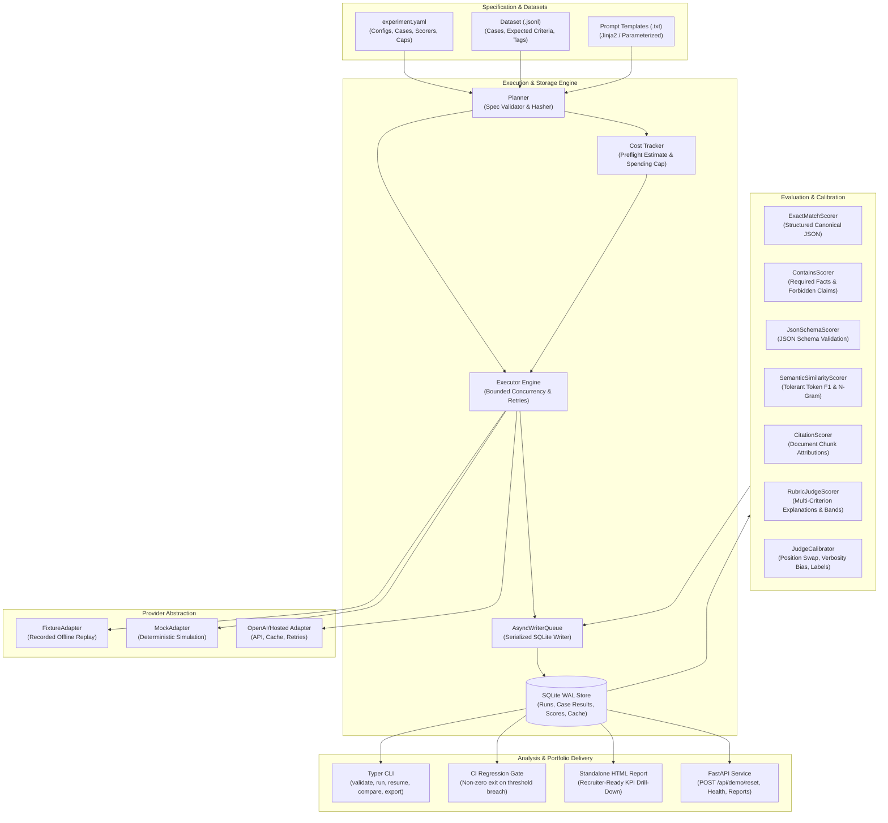

# EvalForge Architecture Specification

EvalForge is a provider-agnostic evaluation harness engineered for benchmarking prompts, configurations, and models across quality, latency, token consumption, and cost.

## High-Level Architecture

## Key Architectural Principles

1. **Deterministic Offline CI Gate**:
   Pull request CI operates 100% offline using recorded fixtures (`fixtures/recorded_responses.json`). No network calls are made during CI, eliminating flakes and budget consumption.
2. **SQLite WAL with Serialized Writer Queue**:
   Parallel async worker tasks generate model outputs concurrently without database locking because all SQLite writes are serialized through an `asyncio.Queue` worker.
3. **No Exact Matching on Generative Text**:
   Exact matching is restricted to canonical structured outputs. Free-form text uses multi-criterion rubrics, semantic overlap, required fact verification, and forbidden claim detection.
4. **Transparent Cost Controls**:
   Preflight estimation alerts developers before execution, and runtime spending caps halt evaluation cleanly before budget overruns occur.
5. **Calibrated Judges**:
   Judges are calibrated for position bias (order-swapped comparisons), verbosity bias, and agreement against human ground truth labels.
